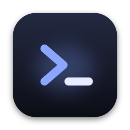
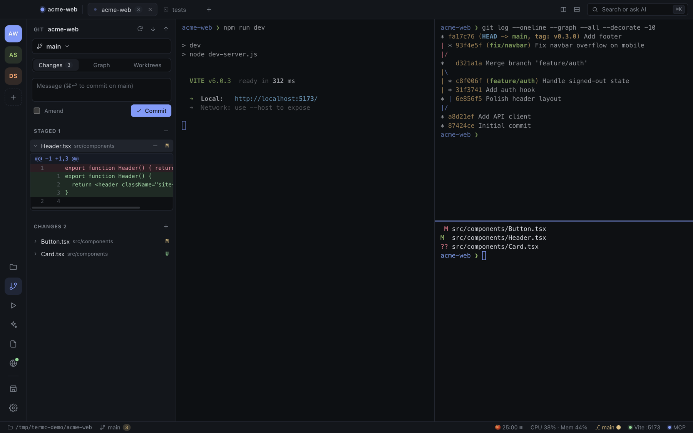
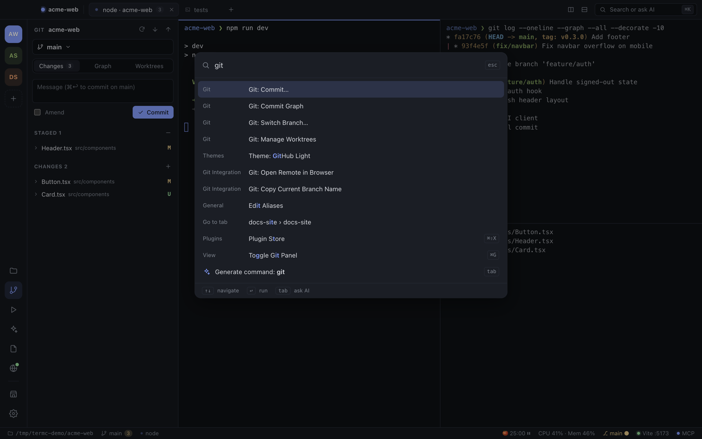
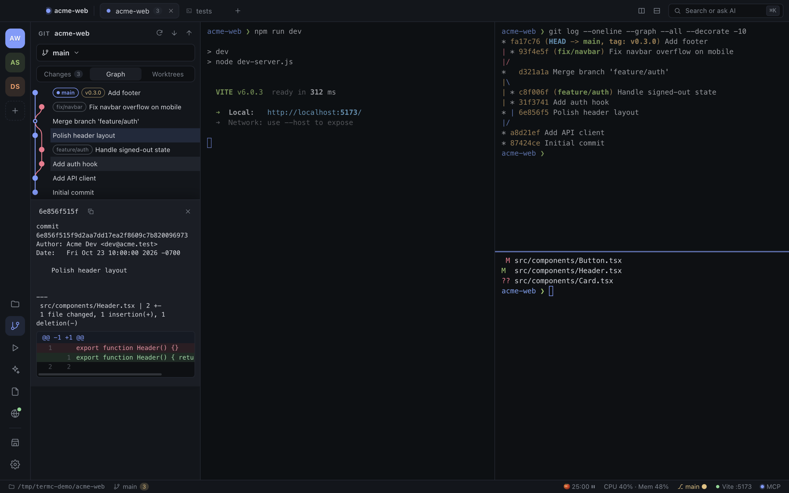
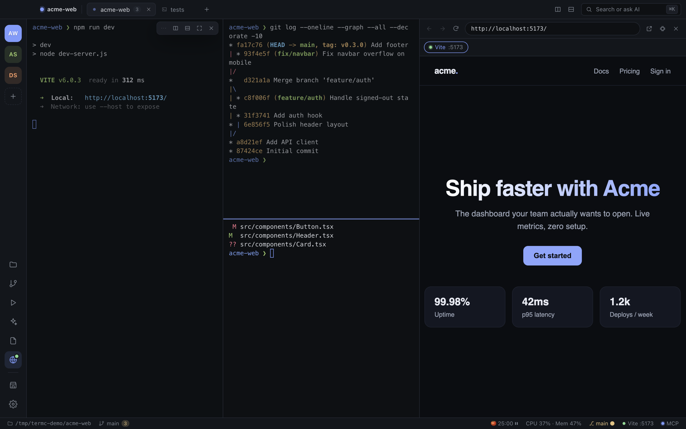
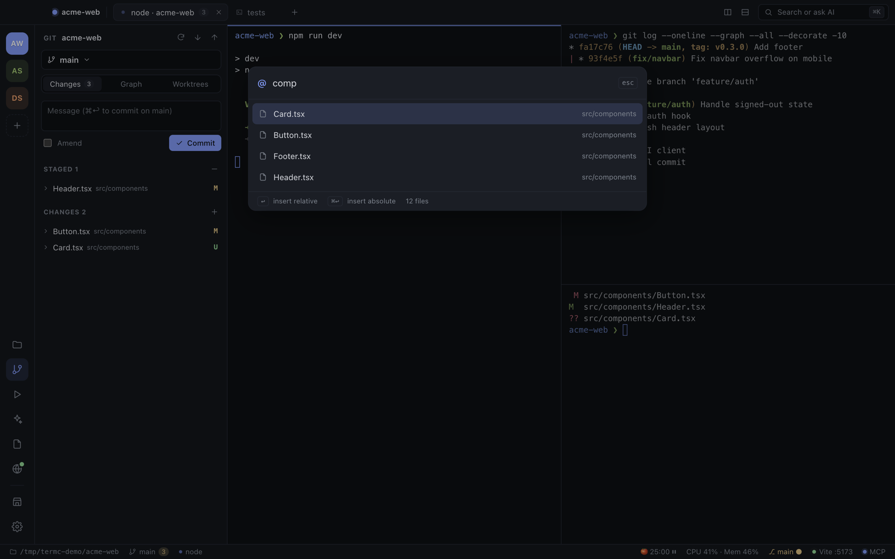
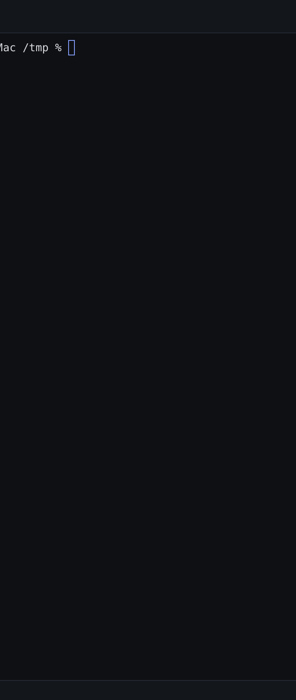
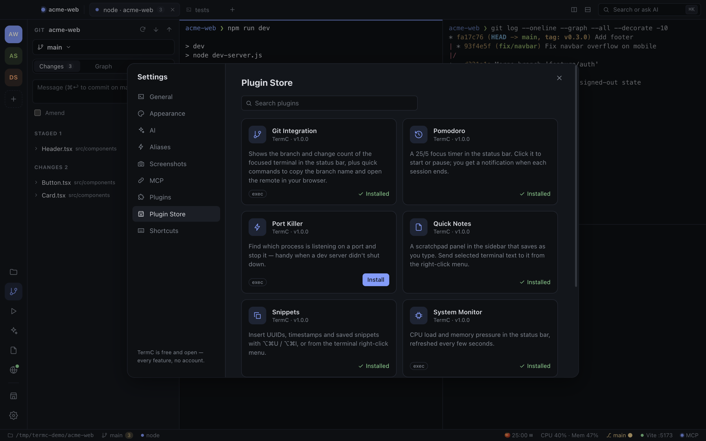
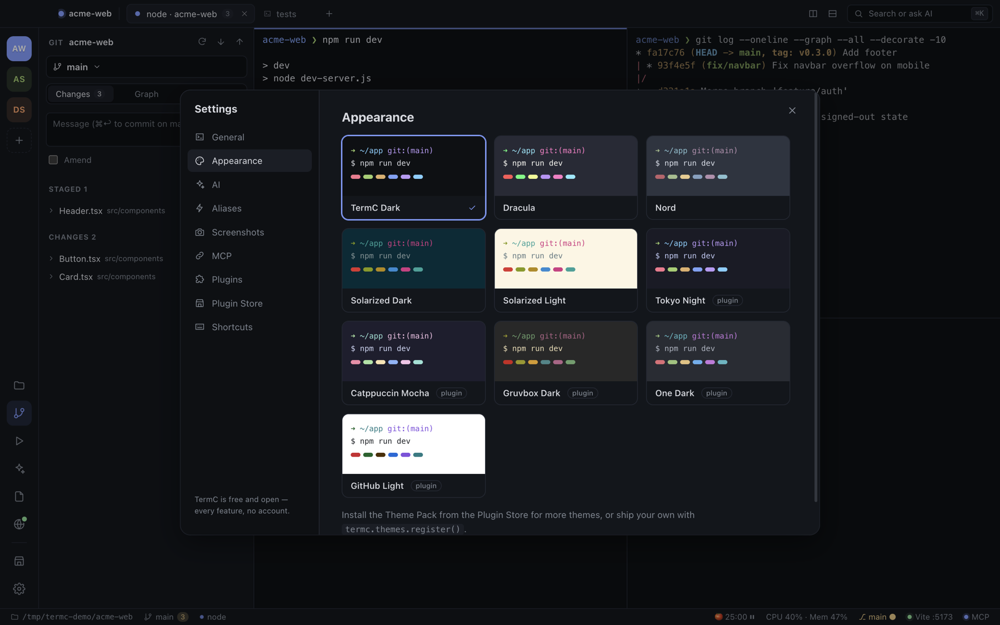

<p align="center">
  
</p>

<h1 align="center">TermC</h1>

<p align="center">
  A fast, good-looking terminal for AI-assisted development.<br />
  Split panes, workspaces, Git, a file browser, dev-server preview, plugins and an MCP server, all in one app.<br />
  <b>Completely free. No account, no paid tier.</b>
</p>

<p align="center">
  <a href="#install">Install</a> ·
  <a href="#features">Features</a> ·
  <a href="docs/README.md">Docs</a> ·
  <a href="docs/mcp.md">MCP</a> ·
  <a href="docs/plugins.md">Plugins</a> ·
  <a href="docs/keyboard-shortcuts.md">Shortcuts</a>
</p>



## Why

I got tired of jumping between Terminal, Warp, a Git client and a browser tab for every project, so I built the terminal I actually wanted. It works well with Claude Code, Codex and Gemini CLI, and every feature is free.

## Install

**macOS (Apple Silicon)**

1. Download `TermC-<version>-arm64.dmg` from [Releases](https://github.com/cliclye/termC/releases), or build it yourself (below).
2. Open the DMG and drag **TermC** into **Applications**.
3. The app is not notarized with a paid Apple Developer ID, so on first launch **right-click TermC → Open**, or run:
   ```bash
   xattr -dr com.apple.quarantine /Applications/TermC.app
   ```

**From source**

```bash
git clone https://github.com/cliclye/termC.git
cd termC
npm install
npm start          # build and run
npm run dist       # produce release/TermC-*.dmg and .zip
```

Requires Node 20+ and the Xcode command line tools (to compile `node-pty`). More in [Getting started](docs/getting-started.md).

## Features

### Tabs, split panes and workspaces

Split horizontally (`⌘D`) or vertically (`⇧⌘D`) as deep as you like. Drag a divider to resize, drag a pane's grip onto another pane's edge to rearrange, and zoom any pane with `⇧⌘↩`. Workspaces (the colored avatars on the left) give each project its own tabs and layout. Everything, including scrollback, comes back after a restart.

### AI-powered commands

Press `⌘K`, describe what you want, and press `Tab`. TermC turns it into a shell command using your current folder, shell and Git branch as context. You can edit it, then Run, Insert or Copy.


It uses AI you already have, so it costs nothing extra: the **Claude Code CLI** (default), a local **Ollama** model, or your own **Anthropic** / **OpenAI-compatible** key.

### Command palette

`⌘K` also fuzzy-searches every action, tab, workspace, theme and plugin command.



### Built-in Git panel

`⌘G` opens status with stage/unstage/discard, **inline diffs**, commit and amend, push/pull/fetch, a branch switcher that can also create branches, a **commit graph** with click-through commit details, and **worktree management**.



### Dev server preview

TermC watches terminal output for local servers (Vite, Next.js, Angular, Nuxt, SvelteKit, Astro, Remix, Django, Rails and more), shows them in the status bar, and opens them in an embedded browser with `⇧⌘B`.



### Files and @-mentions

The file browser (`⌘B`) colors files by Git status. Drag files from it, or from Finder, into any terminal to insert their paths. `⌘P` opens a fuzzy file picker. While Claude Code, Codex or Gemini is running in the pane, it inserts `@path/to/file`.



### AI session resume

TermC notices when Claude Code, Codex CLI or Gemini CLI is running in a pane. If the app quits or crashes mid-session, that pane shows **Session detected → Resume** the next time you open it. The AI Sessions sidebar (`⇧⌘A`) lists recent sessions for the current folder.

### Screenshots for Claude Code

Press `⌃⇧⌘S` anywhere on your Mac (or `⇧⌘S` inside TermC) and select a region. The image is saved per project and its path is pasted into the focused pane, where Claude Code shows it as `[Image #N]`. The shortcut is configurable, and Settings → Screenshots has the full history.

### Spotify, without leaving the terminal

Press `⇧⌘M` for a full player in the sidebar: album art, seek, shuffle, repeat, volume and your saved playlists. A mini player in the status bar shows the current song with previous / play / next, and `⌥⌘P`, `⌥⌘.` and `⌥⌘,` work from anywhere in TermC. Paste any Spotify link to play it or save it. Every saved item also shows up in `⌘K` as "Spotify: Play …". It controls the Spotify app on your Mac, so there's no login or API key.

<p align="center"></p>

### MCP server: let agents drive your terminal

The 78 MCP tools let Claude Code, Cursor and Windsurf run commands and read their output, split panes, manage tabs and workspaces, use Git, search files, open previews and even change the music.

```bash
claude mcp add --scope user termc -e ELECTRON_RUN_AS_NODE=1 -- \
  /Applications/TermC.app/Contents/MacOS/TermC \
  /Applications/TermC.app/Contents/Resources/app.asar.unpacked/mcp/termc-mcp.js
```

See the [MCP guide](docs/mcp.md) for Cursor/Windsurf config and the full tool reference.

### Run commands, aliases and more

- **Run commands** (`⇧⌘R`): detects npm/pnpm/yarn/bun scripts, Makefile and justfile targets, cargo, go, python and docker compose. One click runs a command in a new split.
- **Aliases**: defined once, work in zsh, bash and fish, and hot-reload in every open terminal.
- **Find in terminal** (`⌘F`), clickable links (localhost links open in the preview), notifications when long commands finish in the background.

### Plugins and themes

Plugins run isolated in Web Workers and can add commands, status bar items, sidebar panels, context-menu entries, keybindings and themes. A built-in store ships eight free plugins: Git Integration, Theme Pack, Pomodoro, Quick Notes, Port Killer, System Monitor, Snippets and Weather.



Themes: TermC Dark, Dracula, Nord, Solarized Dark/Light, plus Tokyo Night, Catppuccin Mocha, Gruvbox, One Dark and GitHub Light from the Theme Pack.



Write your own plugin in a few lines; see the [plugin guide](docs/plugins.md).

### Safe by default

TermC asks before quitting or closing a pane would stop something that's still running (a dev server, Claude Code, a build). If the interface ever crashes or freezes, it reloads and reconnects to your shells without losing them.

### Smooth by default

Panels slide, overlays fade and scale, new panes and tabs grow into place, and theme changes cross-fade. All motion respects macOS **Reduce motion**.

## Documentation

| Guide | |
|---|---|
| [Getting started](docs/getting-started.md) | Install, first run, permissions, building from source |
| [Features](docs/features.md) | Every feature in detail |
| [Keyboard shortcuts](docs/keyboard-shortcuts.md) | Full shortcut reference |
| [AI features](docs/ai.md) | AI commands, providers, session resume, screenshots |
| [MCP server](docs/mcp.md) | Setup for Claude Code / Cursor / Windsurf and all 78 tools |
| [Plugins](docs/plugins.md) | Plugin API reference and examples |
| [Architecture](docs/architecture.md) | How the app is put together, for contributors |
| [Troubleshooting](docs/troubleshooting.md) | Common problems and fixes |

## Data and privacy

TermC has no telemetry and no account. Settings, layouts, scrollback, aliases, plugin data and screenshots live in `~/.termc` (override with `TERMC_HOME`). API keys are encrypted with the macOS keychain. The MCP bridge only listens on `127.0.0.1` and needs a random token that changes on every launch.

## License

MIT
