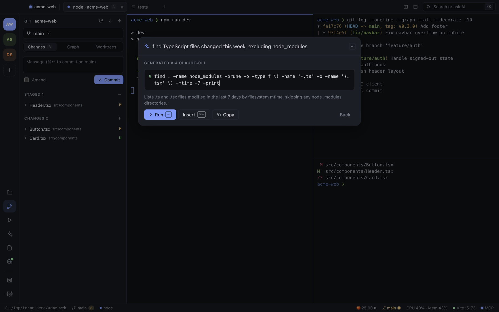

# AI features

## AI commands

1. Press `⌘K` (or `⇧⌘K` to go straight to AI mode).
2. Describe what you want: *"find TypeScript files changed this week"*, *"kill whatever is on port 3000"*, *"undo my last commit but keep the changes"*.
3. Press `Tab` (or `↩` if nothing in the palette matches).
4. TermC shows the generated command, which you can edit, with a one-line explanation. `↩` runs it in the pane you came from, `⌘↩` inserts it without running, and **Copy** copies it.

The request includes context so results fit your machine: macOS, your shell, the working directory, the Git branch and number of changes, and the names of the entries in the folder. File contents are never sent.

### Providers

TermC has no paid AI tier. It uses what you already have. Choose in Settings → AI:

| Provider | Cost | Setup |
|---|---|---|
| **Automatic** (default) | — | Uses the first available: Claude Code CLI → Ollama → Anthropic key → OpenAI-compatible key |
| **Claude Code CLI** | Included with your Claude plan | Install [Claude Code](https://claude.com/claude-code) and log in. TermC runs `claude -p` with the Haiku model |
| **Ollama** | Free, fully local | `brew install ollama && ollama serve && ollama pull llama3.2`, then pick the model in Settings |
| **Anthropic API** | Your API usage | Paste a key; default model `claude-haiku-5-5` |
| **OpenAI-compatible** | Your API usage | Base URL + key + model. Works with OpenAI, Groq, Together, LM Studio, etc. |

Keys are encrypted with the macOS keychain (Electron `safeStorage`) before being written to `~/.termc/settings.json`. **Test AI command** in Settings → AI checks your setup.

## AI session resume

TermC checks each pane's foreground process once a second. When it sees **Claude Code** (`claude`), **Codex CLI** (`codex`) or **Gemini CLI** (`gemini`):

- the tab gets a ✦ icon and is titled after the tool, and the status bar shows it;
- the session is recorded in the saved layout.

If TermC quits, crashes or the Mac restarts while the agent is still running, that pane shows a banner next time:

> **Session detected** · Claude Code session from 2h ago was interrupted · **Resume** · Dismiss

**Resume** runs the right command in the same folder:

| Tool | Command |
|---|---|
| Claude Code | `claude --resume <id>` for the exact session (found in `~/.claude/projects/<folder>/`), else `claude --continue` |
| Codex CLI | `codex resume --last` |
| Gemini CLI | `gemini --resume latest` |

The **AI Sessions** sidebar (`⇧⌘A`) also lists recent sessions for the current folder from all three tools, with one-click Resume into a new tab.

## Screenshots for Claude Code

1. Press `⇧⌘S` anywhere. It's a global shortcut, so TermC doesn't need focus.
2. Drag to select a region (press Space to pick a window, Esc to cancel).
3. The PNG is saved to `~/.termc/screenshots/<project>/` and its path is pasted into the focused pane. Claude Code turns a pasted image path into `[Image #N]`.

Settings → Screenshots lets you change the shortcut, browse the history per project, re-insert, reveal or trash shots, and open the folder in Finder. macOS asks for **Screen Recording** permission the first time.

## Agents controlling TermC

To let Claude Code, Cursor or Windsurf drive TermC (run commands, split panes, open previews), see [MCP](mcp.md).
